<p align="center">
  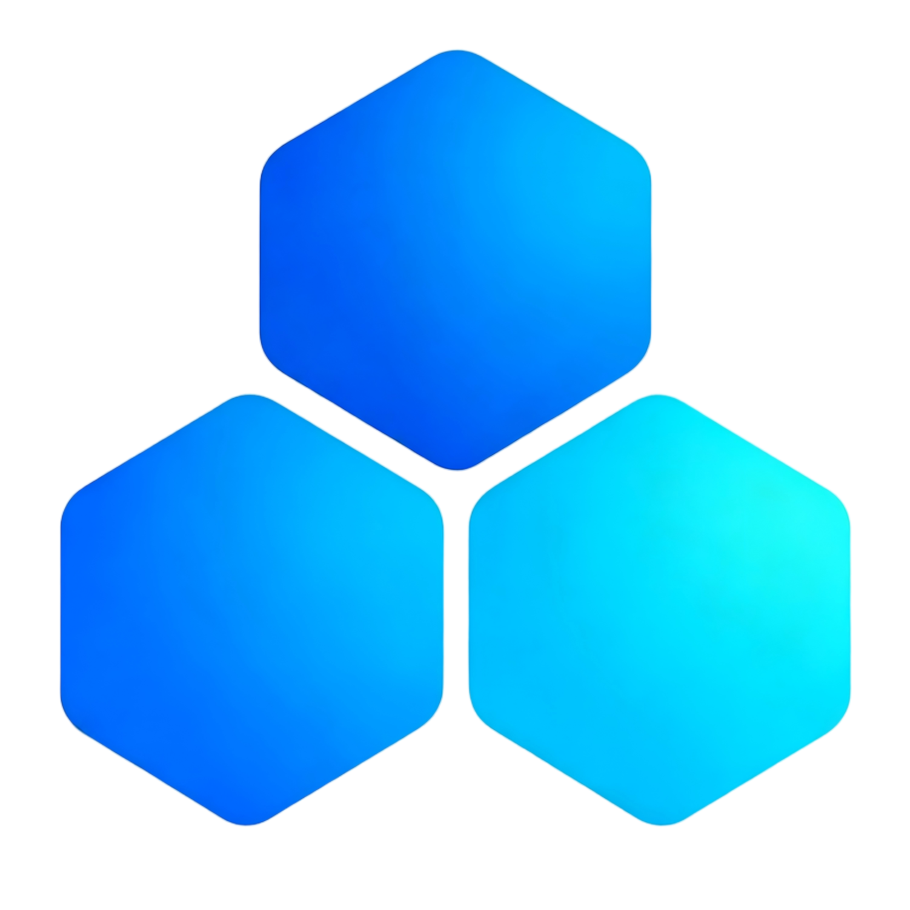
</p>

<h1 align="center">DSH Marina</h1>

<p align="center">
  A high-performance desktop launcher built with Rust for running isolated
  <a href="https://github.com/deepseek-ai/deepseek-harness">DeepSeek Harness (DSH)</a>
  workspaces side by side on Windows and macOS.
</p>

<p align="center">
  
  
  
</p>

<p align="center">
  <strong>English</strong> · <a href="README.zh-CN.md">简体中文</a>
</p>

<p align="center">
  Source: <a href="https://github.com/QuaonY/dsh-marina">GitHub</a> ·
  <a href="https://cnb.cool/QuaonY/dsh-marina">CNB</a> ·
  <a href="https://github.com/QuaonY/dsh-marina-packs">Community packs</a>
</p>

---

DSH normally reads from a single user profile. Marina gives every workspace its own `DSH_HOME`,
Electron data directory, plugin set, and logs, so several DSH versions can run at the same time
without interfering with each other. It also handles the day-to-day work around that setup:
launching and stopping, installing runtimes, taking snapshots, recovering from crashes, and
sharing a ready-to-use configuration with someone else.

Marina is a separate launcher, not a DSH fork: it starts the official DSH build with isolated paths.

## Platform support

| Platform | Architecture | Minimum | Installer |
| --- | --- | --- | --- |
| Windows | x64 | Windows 10 21H2 (DirectX 11) | NSIS installer |
| macOS | Apple Silicon (arm64) | macOS 13 Ventura | `.dmg` |

<p align="center">
  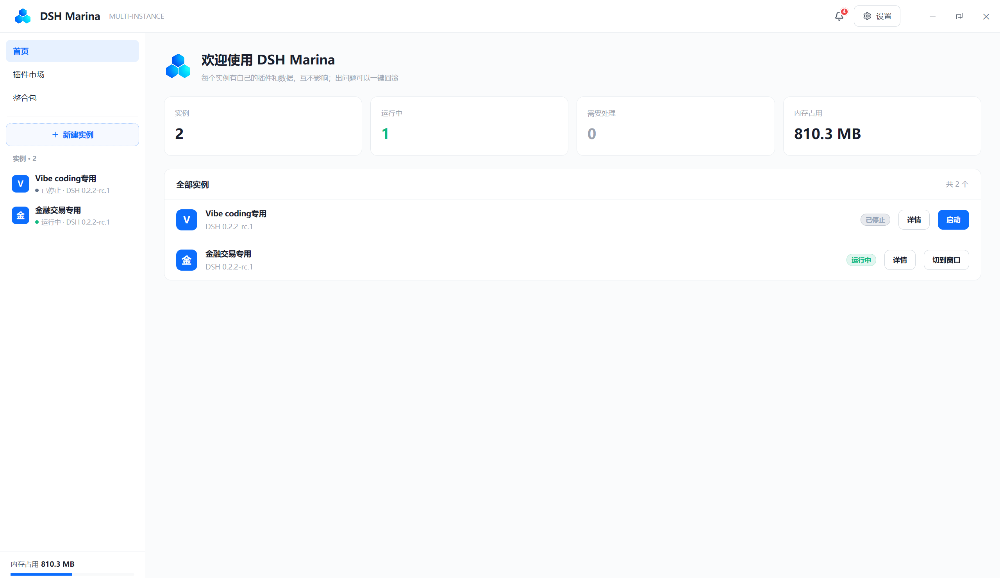
</p>

<p align="center"><sub>One window for every instance, version, plugin, and snapshot.</sub></p>

## Getting started

### Windows

1. Download the installer `dsh-marina-setup-v<version>-windows-x64.exe` and run it.
2. Create an instance and pick a DSH runtime version, or let Marina download one.
3. Start the instance. Plugins, snapshots, packs, and the tray are all managed from this window.

The installer installs per-user (no administrator rights), creates a desktop shortcut and a Start
menu entry, and lands under "Apps and features".

### macOS

1. Download `dsh-marina-v<version>-macos-aarch64.dmg`, open it, and drag **DSH Marina** into
   Applications; or use Homebrew:

   ```bash
   brew tap QuaonY/dsh-marina
   brew install --cask dsh-marina
   ```

2. **First launch (important):** Marina uses free ad-hoc signing (no Apple Developer account), so
   macOS blocks the un-notarized app. If the first open says the developer cannot be verified, go
   to **System Settings → Privacy & Security**, click **"Open Anyway"** near the bottom, and enter
   your password. After that it launches normally.
3. Create an instance and start it.

## Features

### Instances

- Create, rename, clone, and delete workspaces, each with its own accent color.
- Cloning leaves out sessions, credentials, anonymous identity, and Electron login state by
  default. The option to copy personal data is only available while the source instance is
  stopped.
- Delete in three safe ways: export first, keep the data in `trash` for 30 days, or move it to the
  system trash (Windows Recycle Bin / macOS Trash).
- A dashboard shows every instance, its runtime, and whether it is running.

<p align="center">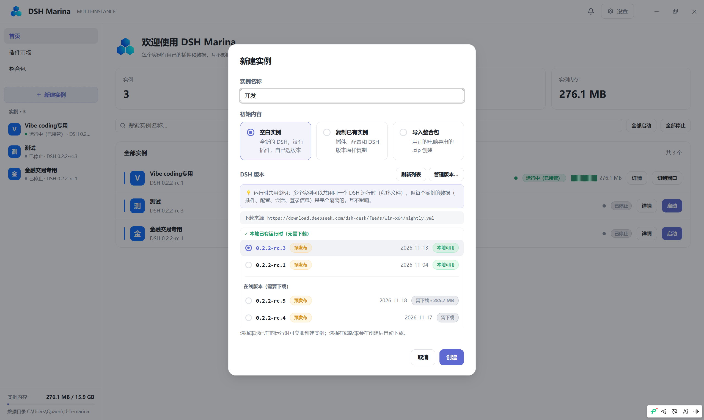</p>

<p align="center">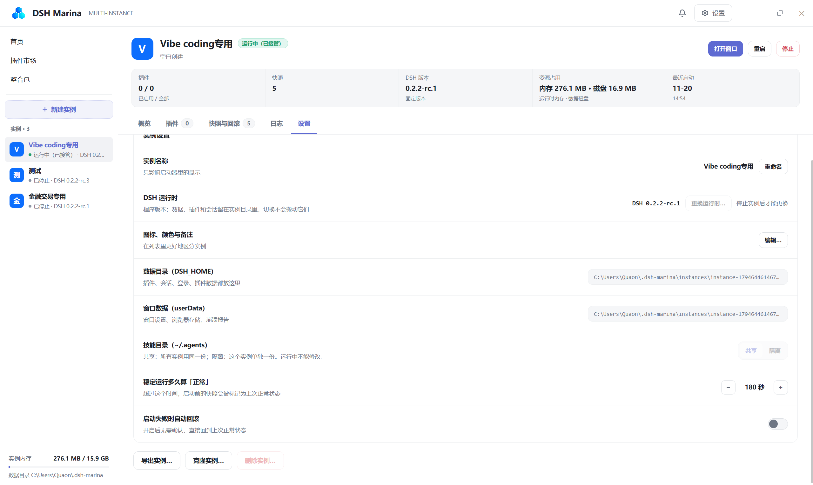</p>

### Process lifecycle

- On Windows each instance runs in its own Job Object; on macOS it is managed as a separate
  process group.
- Stop sends a gentle close signal first (Windows `WM_CLOSE` / macOS terminate signal), waits 30
  seconds, then force-kills the process tree.
- Instances that keep running after Marina restarts are adopted on the next launch.
- Readiness is read from the `dsh web: http://127.0.0.1:<port>/` line and confirmed by probing the
  port.
- DSH stdout and stderr go to `marina/stdout-*.log`; tokens are redacted and the file is capped at
  4 MB.

<p align="center">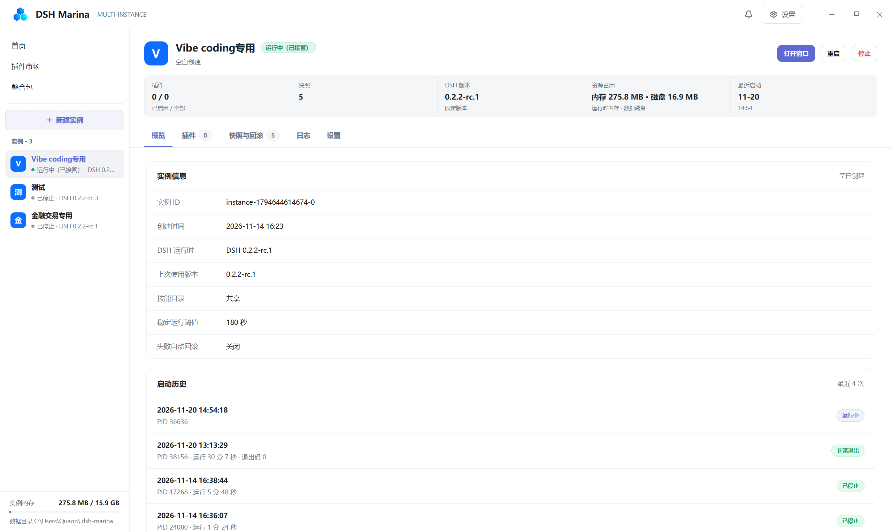</p>

### Plugins

- List third-party plugins and enable or disable them through `cordis.patch.yml`, with an automatic
  backup before every change.
- One-click safe mode for a workspace that will not start.
- Uninstall plugins and reinstall dependencies through the runtime's bundled
  `dsh plugin --profile desktop` CLI.
- Marina refuses plugin writes while the instance is running, so a live workspace is never changed
  underneath DSH.

### Plugin market

- Browse a remote index and search by name, title, author, description, category, and declared
  capabilities. Every word in a query must match.
- Install a plugin into a chosen instance and see download and star counts.
- Run state is respected: installing and changing plugins is disabled while the target is running.

<p align="center">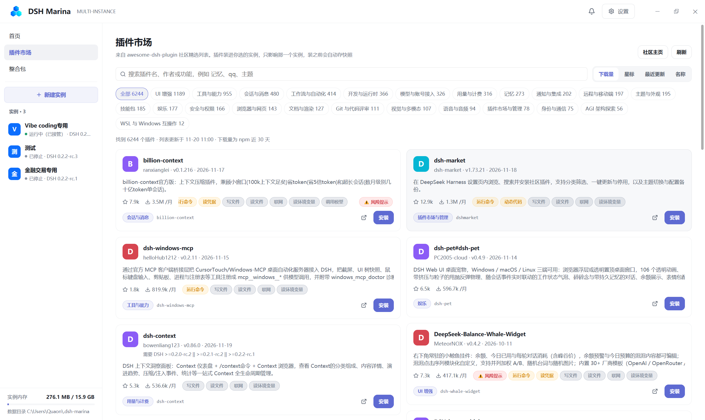</p>

### Snapshots and rescue

- Manual snapshots plus an automatic snapshot before each launch.
- Mark a stable run as last-good.
- Attribute a crash to suspicious plugins, disable them, or roll back to last-good: restore the
  snapshot, reinstall plugin dependencies, then optionally restart.
- Optional automatic rollback, off by default.

<p align="center">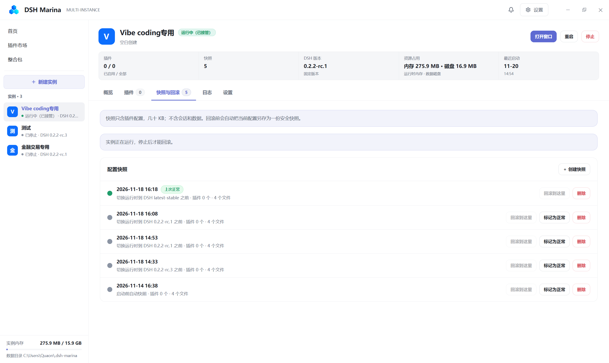</p>

### Runtimes

- Keep several DSH versions side by side and bind an instance to a specific version or to "latest
  stable".
- Download from the official feed (nightly or stable), GitHub Releases, a GitHub mirror prefix, or
  a custom feed, with automatic fallback.
- Resumable downloads and SHA-512 verification; Windows uses silent NSIS installation, macOS
  unpacks the official `.zip` with `ditto` (preserving the symlinks inside the `.app`).
- Installers dropped into `runtimes/` are installed offline.
- Marina checks for a new version once a day and suggests cleanup when more than `max_runtimes`
  are installed.
- Switching a running instance to a newly released DSH keeps everything: in the instance's Settings
  tab, "Switch runtime…" rebinds it in place, with data, plugins, sessions and logins untouched. A
  snapshot is taken first, and "Switch back to the previous runtime" reverts the change. The same
  dialog also switches back to following "latest stable".

<p align="center">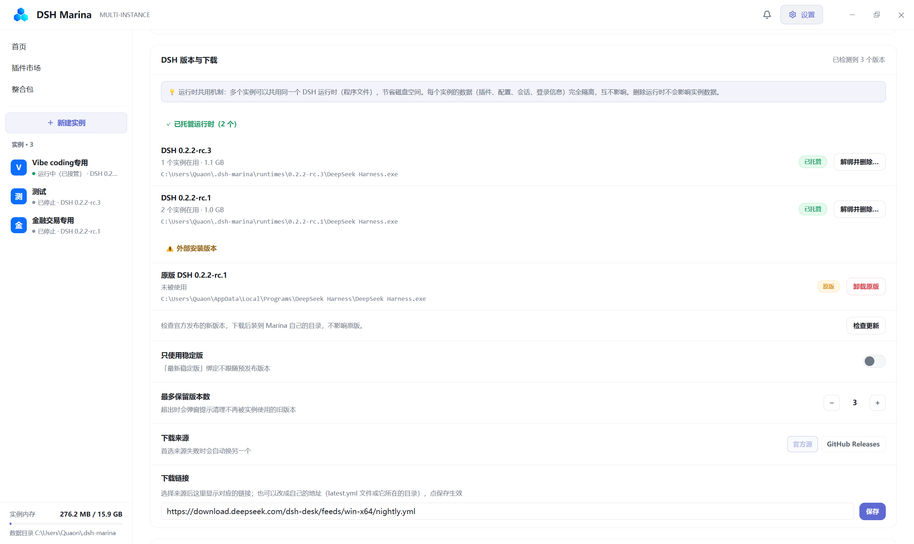</p>

### Marina Packs

- Export an instance to a `.marina-pack.zip` and import it again.
- Share a pack to the community catalog through GitHub Device Flow, with the `public_repo` scope:
  Marina publishes the archive as a Release in the user's `dsh-marina-shared-packs` repository,
  then opens a pull request with the metadata against
  [QuaonY/dsh-marina-packs](https://github.com/QuaonY/dsh-marina-packs). Validation runs
  automatically; a maintainer merges the pull request.
- The share flow scans the exported files and redacts credentials and absolute paths.

<p align="center">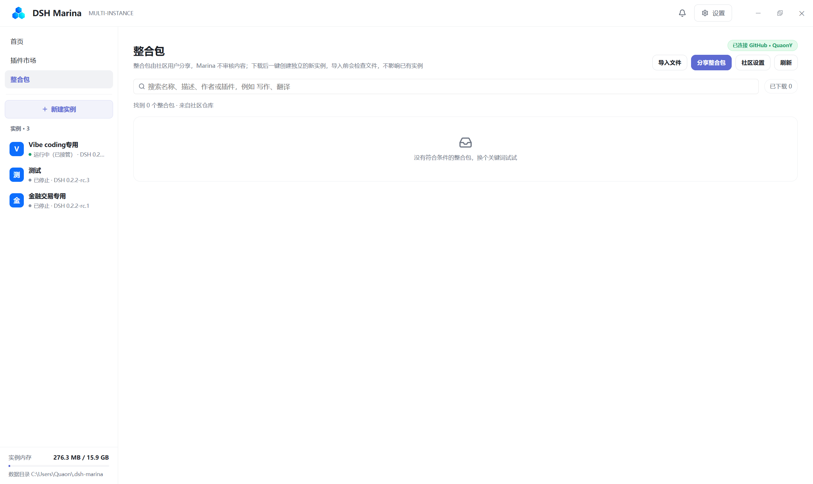</p>

### Tray and desktop integration

- Closing the window hides Marina to the system tray; a left click/double-click on the tray icon
  brings the main window back, right-click opens the tray menu, and quitting is done from the menu.
- A tray menu per instance, plus a tooltip with the running count and total memory.
- Start with the OS, single-instance handling, and an optional exit confirmation that lists
  running instances.
- Full uninstall with separate options for the application and user data.

<p align="center">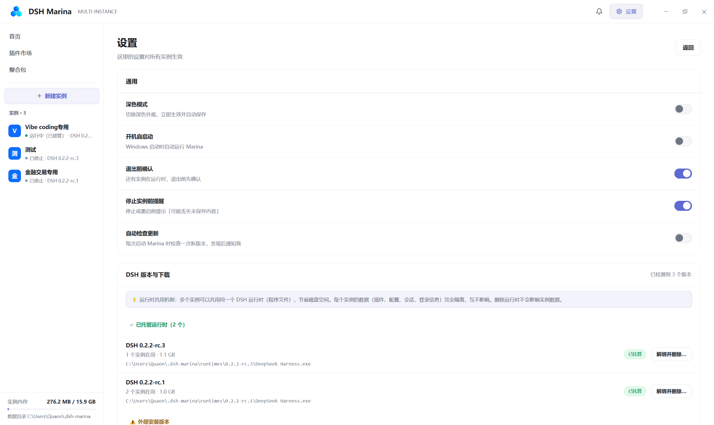</p>

### About

- Version, MIT license, repository link, and the full third-party license list.

<p align="center">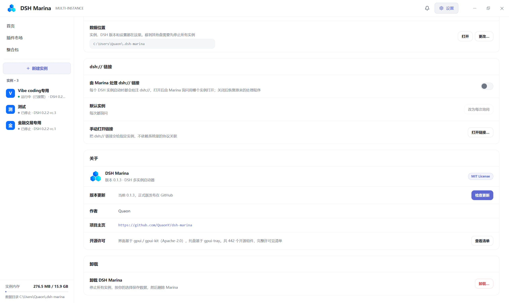</p>

### Updates

- Marina checks the update manifest once per launch (GitHub raw first, falling back to the CNB
  mirror when GitHub is unreachable). A new version shows a red dot on the bell.
- The update dialog shows the current and the new version, that release's notes, and a link to the
  release page.
- "Download and update" shows progress, then verifies the package's **SHA-256** against the manifest
  before offering "Restart and update" or "Later". Windows downloads the NSIS
  installer; macOS downloads the `.app.tar.gz`.
- With instances running, restarting first asks; choosing "update on exit" installs the downloaded
  build the next time Marina quits. The Windows installer runs in passive mode and relaunches
  automatically; macOS replaces the `.app` and restarts.
- The check can be turned off under Settings → General.

## Data and privacy

Everything lives under `.dsh-marina` in your home folder by default (Windows
`%USERPROFILE%\.dsh-marina\`, macOS `~/.dsh-marina/`):

```text
.dsh-marina/
├─ marina.toml
├─ instances/
│  └─ <id>/
│     ├─ home/          DSH_HOME
│     ├─ electron/      Electron --user-data-dir
│     ├─ marina/        Marina's per-instance state and stdout logs
│     └─ snapshots/
├─ runtimes/<version>/
├─ download/
├─ updates/             self-update downloads and staged packages
├─ trash/
├─ github_token.json    encrypted GitHub token
└─ marina.log
```

- The data directory can be changed in Settings. Marina moves the files, verifies the copy, and
  only then removes the old directory.
- Nothing is written next to the program, so it can be moved or replaced freely.
- The GitHub token is encrypted with Windows DPAPI on Windows and stored in the system Keychain on
  macOS, and is only decrypted for the current user. Logs and exported packs redact tokens,
  credentials, and local absolute paths.
- Marina has no analytics or telemetry. Network access happens only for what the feature at hand
  needs: update checks, runtime downloads, the plugin market, and community sharing.

## Building from source

### Prerequisites

- Rust 1.88+ (edition 2024)
- Windows: Windows 10 21H2+, a DirectX 11 driver, Visual Studio Build Tools with the Windows SDK
  (for `rc.exe`, the window icon)
- macOS: macOS 13+, Xcode Command Line Tools (Metal shader compilation and `ditto`)

### Build

```bash
cargo build --release
```

The result is `target\release\dsh-marina.exe` on Windows and `target/release/dsh-marina` on macOS.
Release builds have no console window.

The Windows executable is fully self-contained: assets are compiled in, and `.cargo/config.toml`
static-links the MSVC C runtime. It does not need `VCRUNTIME140.dll` or the Visual C++
Redistributable. The remaining imports (`kernel32`, `user32`, `d3d11`, `dwrite`, `secur32`, and so
on) ship with Windows.

The icon is generated from `assets/logo.png` during the build (`.ico` on Windows, `.icns` on
macOS).

### Packaging a release (all-Rust, `cargo xtask`)

Release orchestration is done entirely by the Rust `xtask` — no PowerShell or hand-written NSIS
scripts:

```bash
# Build + package on the current platform; artifacts + SHA-256 + a fragment go into dist/
cargo xtask package

# Merge the per-platform fragments + the matching CHANGELOG section into update.json
cargo xtask manifest --tag v<version> --notes CHANGELOG.md
```

- Windows produces the NSIS installer (update package) + its `.sha256` file;
  macOS produces the `.app.tar.gz` (update package) + `.dmg` (fresh install).
- `update.json` stays compatible with the old manifest: it keeps `tag_name/html_url/body/assets` for
  v0.1.2 clients and adds `version/notes/pub_date/platforms` for the new updater.
- Release is fully automatic on push: `.github/workflows/release.yml` builds both platforms, publishes
  the GitHub Release, commits `update.json` back to main and (with `CNB_GIT_TOKEN`) syncs CNB code and
  (with `CNB_TOKEN`) creates the CNB Release with all assets uploaded.
  Bump `Cargo.toml` version + append a `## <version>` section to `CHANGELOG.md` (bilingual, newest
  first), then push — nothing else is manual. The pipeline extracts that section as the Release body.
- `.github/workflows/ci.yml` runs fmt / clippy / test on pull requests. Neither workflow needs secrets
  for signing; `CNB_GIT_TOKEN` / `CNB_TOKEN` are optional and only used for the CNB mirror / Release.

## Development

```bash
cargo fmt --check
cargo clippy --all-targets -- -D warnings
cargo test
cargo run
```

`cargo build` keeps a console window for logs; `cargo build --release` hides it. CI runs format,
clippy, and tests on both Windows and macOS (arm64) runners.

### Manual testing

Automated tests cover the core logic. The following still need a real desktop:

- Downloads from the different runtime sources (Windows silent NSIS / macOS `ditto` unpack)
- `dsh plugin` CLI integration
- Tray behavior and GUI interactions (including left-click to restore the window)
- Process lifecycle details (Windows Job Objects / macOS process groups)
- Self-update: Windows passive NSIS install + relaunch, macOS `.app` replacement + restart, and the
  "update on exit" path
- macOS Gatekeeper first-launch allowance and re-allowance after an update
- The GitHub sharing flow (Device Flow, Release upload, pull request)

## Tech stack

| Area | Used |
| --- | --- |
| UI | [gpui-kit](https://github.com/longbridge/gpui-kit) |
| System tray | [gpui-tray](https://github.com/domenkozar/gpui-tray) |
| OS integration | Windows `windows` crate (Job Objects, registry, shell); macOS `objc2` / `libc` / `security-framework` |
| Networking | `reqwest` with native TLS and the system proxy |
| Data formats | serde, TOML, YAML, JSON, and ZIP |
| Packaging | [cargo-packager](https://github.com/crabnebula-dev/cargo-packager) (NSIS / `.app` / `.dmg`) |
| Self-update | [cargo-packager-updater](https://github.com/crabnebula-dev/cargo-packager) (SHA-256 verification) |
| Release orchestration | `xtask` (all-Rust) |

## Project layout

```text
src/            application modules (instances, process, plugins, packs, platform abstraction, …)
src/platform/   Windows / macOS platform abstraction (window, single instance, disk space)
src/process/    process backends (Job Object / process group)
src/ui/         GPUI views, dialogs, and tab pages
src/bin/        fake-desktop test double used by the integration tests
tests/          process lifecycle integration tests
xtask/          all-Rust release orchestration (package, SHA-256, manifest)
packaging/      distribution material such as the Homebrew Cask template
assets/         logo, icons, screenshots, and the third-party license list
CHANGELOG.md    cumulative bilingual changelog (one section per release)
```

## Contributing

Issues and pull requests are welcome.

## License

MIT. See [LICENSE](LICENSE).

## Acknowledgments

- Author and maintainer: Quaon
- DeepSeek Harness is developed by DeepSeek: [deepseek-ai/deepseek-harness](https://github.com/deepseek-ai/deepseek-harness)
- Built on GPUI
- Uses the gpui-kit component library
- Third-party licenses: [assets/THIRD-PARTY-LICENSES.txt](assets/THIRD-PARTY-LICENSES.txt)