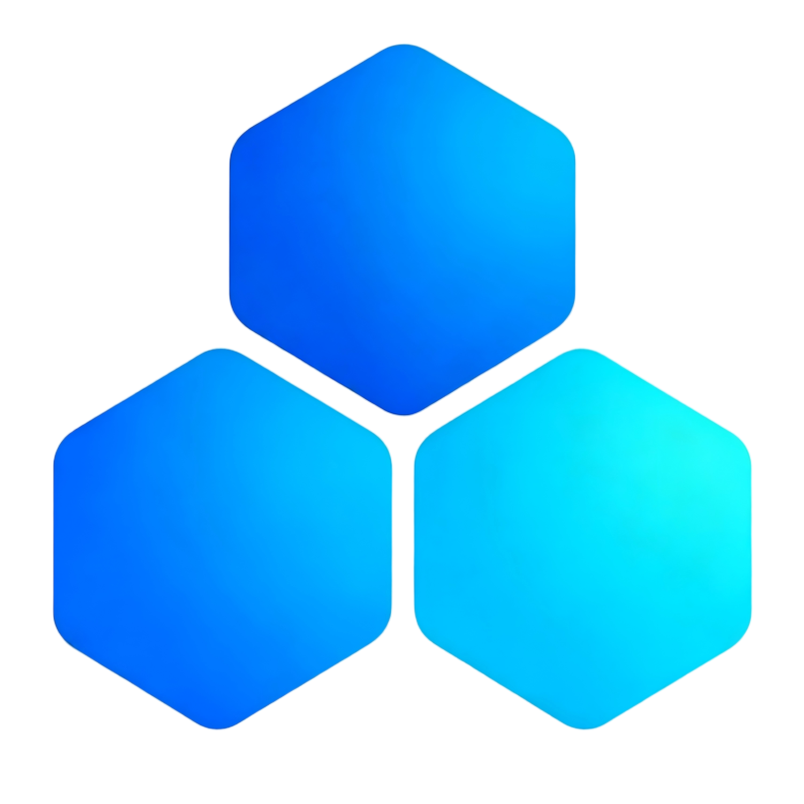

<p align="center">
  
</p>

<h1 align="center">DSH Marina</h1>

<p align="center">
  一个用于并排运行多个相互隔离的
  <a href="https://github.com/deepseek-ai/deepseek-harness">DeepSeek Harness（DSH）</a>
  工作区的 Windows 桌面启动器。
</p>

<p align="center">
  
  
  
</p>

<p align="center">
  <a href="README.md">English</a> · <strong>简体中文</strong>
</p>

<p align="center">
  源码：<a href="https://github.com/QuaonY/dsh-marina">GitHub</a> ·
  <a href="https://cnb.cool/QuaonY/dsh-marina">CNB</a> ·
  <a href="https://github.com/QuaonY/dsh-marina-packs">社区整合包</a>
</p>

---

DSH 默认只读取一份用户配置。Marina 为每个工作区分配独立的 `DSH_HOME`、Electron 数据目录、插件集合和日志，因此多个 DSH 版本可以同时运行，互不干扰。它还负责这套环境周边的日常操作：启动与停止、安装运行时、创建快照、崩溃恢复，以及把配置好的环境分享给别人。

Marina 是独立的启动器，而不是 DSH 的分支：它使用隔离的路径启动官方 DSH 版本。它仅支持 Windows（Windows 10 21H2 及以上，DirectX 11），构建产物是一个自包含的可执行文件，不需要安装程序，也不需要 Visual C++ 运行库。

<p align="center">
  
</p>

<p align="center"><sub>一个窗口管理所有实例、版本、插件和快照。</sub></p>

## 快速开始

1. 从[源码](#从源码构建)构建 `dsh-marina.exe`。
2. 新建实例，并选择 DSH 运行时版本，或让 Marina 自动下载。
3. 启动实例。插件、快照、整合包和托盘都在同一个窗口里管理。

## 功能

### 实例管理

- 创建、重命名、克隆和删除工作区，每个实例可以设置独立的主题色。
- 克隆默认不包含会话、凭据、匿名身份和 Electron 登录状态。只有源实例处于停止状态时，才允许勾选「同时复制个人数据」。
- 删除提供三种安全方式：先导出再删除、在 `trash` 中保留 30 天，或移动到 Windows 回收站。
- 首页集中展示所有实例、绑定的运行时以及当前运行状态。

### 进程生命周期

- 每个实例运行在独立的 Windows Job Object 中。
- 停止时先发送 `WM_CLOSE`，等待 5 秒后再终止整个进程树。
- Marina 重启后，会接管仍在运行的实例。
- 从 `dsh web: http://127.0.0.1:<port>/` 这一行判断启动是否就绪，并探测端口进行确认。
- DSH 的标准输出和错误输出写入 `marina/stdout-*.log`，其中令牌会被脱敏，文件上限为 4 MB。

### 插件

- 列出第三方插件，并通过 `cordis.patch.yml` 启用或禁用；每次修改前自动备份。
- 工作区无法启动时，可以一键进入安全模式。
- 通过运行时自带的 `dsh plugin --profile desktop` CLI 卸载插件、重装依赖。
- 实例运行期间拒绝任何插件写入，避免在 DSH 使用过程中改动配置。

### 插件市场

- 浏览远程索引，可按名称、标题、作者、描述、分类和声明的能力搜索；查询中的每个词都必须匹配。
- 将插件安装到指定实例，并查看下载量和星标数。
- 会遵循实例的运行状态：目标实例正在运行时，安装和修改插件都会被禁用。

### 快照与救援

- 支持手动快照，并在每次启动前自动创建快照。
- 将稳定运行过的状态标记为「上次正常」。
- 崩溃后可以定位可疑插件、禁用它们，或回滚到「上次正常」：恢复快照、重装插件依赖，然后可选地重新启动。
- 可选的自动回滚，默认关闭。

### 运行时

- 同时保留多个 DSH 版本，实例可以绑定指定版本或「最新稳定版」。
- 下载源支持官方源（nightly 或 stable）、GitHub Releases、GitHub 镜像前缀或自定义源，并自动回退。
- 支持断点续传、SHA-512 校验和 NSIS 静默安装。
- 放入 `runtimes/` 的安装包可以离线安装。
- 每天检查一次新版本；安装数量超过 `max_runtimes` 时会提示清理。
- 官方发布新版本后，可以直接把已有实例升级到新运行时：在实例「设置」里点「更换运行时…」，原地切换 DSH 版本，数据、插件、会话和登录状态都不动。切换前会自动存快照，出问题可以「换回上一个运行时」；也可以在这里改回跟随「最新稳定版」。

### Marina 整合包

- 将实例导出为 `.marina-pack.zip`，也可以再次导入。
- 通过 GitHub Device Flow 和 `public_repo` 权限分享到社区：Marina 先把压缩包发布到用户的 `dsh-marina-shared-packs` 仓库 Release，再向
  [QuaonY/dsh-marina-packs](https://github.com/QuaonY/dsh-marina-packs) 提交包含元数据的 Pull Request。校验会自动运行，最终由维护者合并。
- 分享流程会扫描导出的文件，并对凭据和本地绝对路径做脱敏。

### 托盘与桌面集成

- 关闭窗口时隐藏到系统托盘，退出只能从托盘菜单执行。
- 每个实例都有独立的托盘菜单；托盘提示显示运行数量和总内存。
- 支持开机自启、单实例运行，以及可选的退出确认（会列出正在运行的实例）。
- 卸载时可以分别选择是否保留用户数据。

### 关于

- 显示版本、MIT 许可证、仓库地址、完整的第三方许可清单，并支持手动检查更新。

## 数据与隐私

所有内容默认位于 `%USERPROFILE%\.dsh-marina\`：

```text
%USERPROFILE%\.dsh-marina\
├─ marina.toml
├─ instances\
│  └─ <id>\
│     ├─ home\          DSH_HOME
│     ├─ electron\      Electron --user-data-dir
│     ├─ marina\        Marina 的实例状态和标准输出日志
│     └─ snapshots\
├─ runtimes\<version>\
├─ download\
├─ trash\
├─ github_token.json    经 DPAPI 加密的 GitHub 令牌
└─ marina.log
```

- 数据目录可以在设置中修改。Marina 会先移动文件、校验副本，确认无误后才删除旧目录。
- 不会在 exe 旁边写入任何内容，因此 exe 可以随意移动或替换。
- GitHub 令牌使用 Windows DPAPI 加密，只有当前 Windows 用户能够解密。日志和导出的整合包会脱敏令牌、凭据和本地绝对路径。
- Marina 不包含统计或遥测。联网只发生在功能需要时：检查更新、下载运行时、插件市场和社区分享。

## 从源码构建

### 环境要求

- Windows 10 21H2 及以上，并具备可用的 DirectX 11 驱动
- Rust 1.88 及以上（edition 2024）
- Visual Studio Build Tools 和 Windows SDK，用于 `rc.exe`（生成窗口图标）

### 构建

```powershell
cargo build --release
```

生成的程序位于 `target\release\dsh-marina.exe`，发布构建不带控制台窗口。

可执行文件完全自包含：资源全部编译进 exe，`.cargo/config.toml` 将 MSVC C 运行库静态链接，因此不需要 `VCRUNTIME140.dll`，也不需要安装 Visual C++ 运行库。其余导入项（`kernel32`、`user32`、`d3d11`、`dwrite`、`secur32` 等）均为 Windows 自带。

图标会在构建时由 `assets/logo.png` 生成。如果找不到 `rc.exe`，构建仍会成功，但会给出警告，程序将使用通用的 Windows 图标。

发布版没有代码签名，首次运行时 Windows SmartScreen 可能会要求确认。

## 开发

```powershell
cargo fmt --check
cargo test
cargo run
```

`cargo build` 会保留控制台窗口以便查看日志；`cargo build --release` 则会隐藏控制台。

### 手动测试

自动化测试覆盖核心逻辑。以下项目仍需要在真实的 Windows 桌面上验证：

- 从不同运行时源下载
- NSIS 静默安装
- `dsh plugin` CLI 集成
- 托盘行为和界面交互
- 进程生命周期细节（Job Object 和窗口消息）
- GitHub 分享流程（Device Flow、Release 上传、Pull Request）

## 技术栈

| 方面 | 使用 |
| --- | --- |
| 界面 | [gpui-kit](https://github.com/longbridge/gpui-kit) |
| 系统托盘 | [gpui-tray](https://github.com/domenkozar/gpui-tray) |
| Windows 集成 | `windows` crate（Job Object、注册表、Shell、进程 API） |
| 网络 | `reqwest`，使用原生 TLS 和 Windows 系统代理 |
| 数据格式 | serde、TOML、YAML、JSON 和 ZIP |

## 项目结构

```text
src/            应用模块（实例、进程、插件、整合包等）
src/ui/         GPUI 视图、对话框和标签页
src/bin/        集成测试使用的 fake-desktop 测试替身
tests/          进程生命周期集成测试
assets/         图标、Logo、截图和第三方许可清单
```

## 参与贡献

欢迎提交 Issue 和 Pull Request。

## 许可证

MIT，详见 [LICENSE](LICENSE)。

## 致谢

- 作者与维护者：Quaon
- DeepSeek Harness 由 DeepSeek 开发：[deepseek-ai/deepseek-harness](https://github.com/deepseek-ai/deepseek-harness)
- 基于 GPUI 构建
- 使用 gpui-kit 组件库
- 第三方许可：[assets/THIRD-PARTY-LICENSES.txt](assets/THIRD-PARTY-LICENSES.txt)
