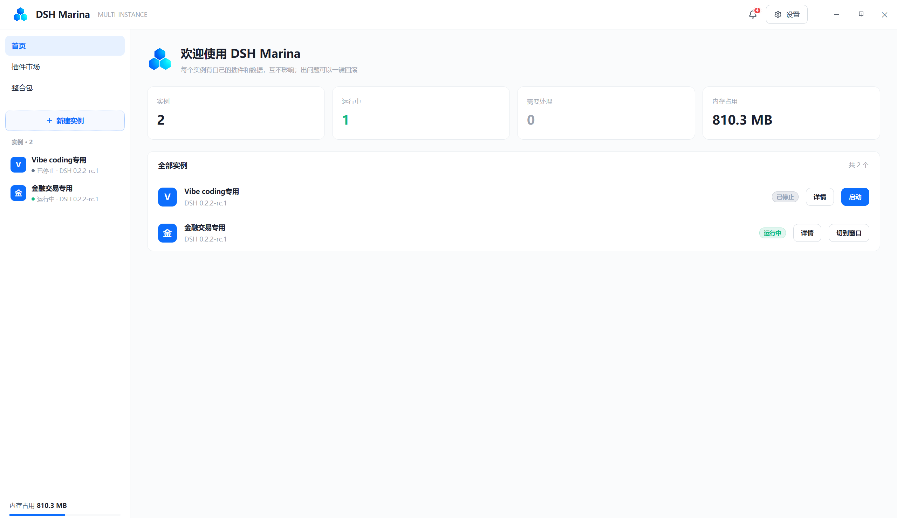
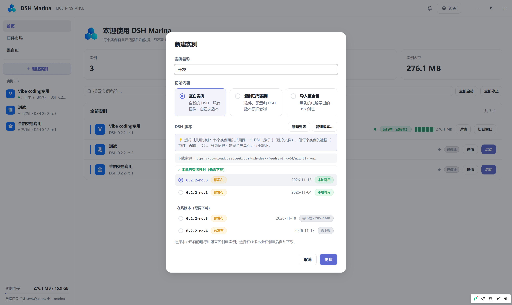
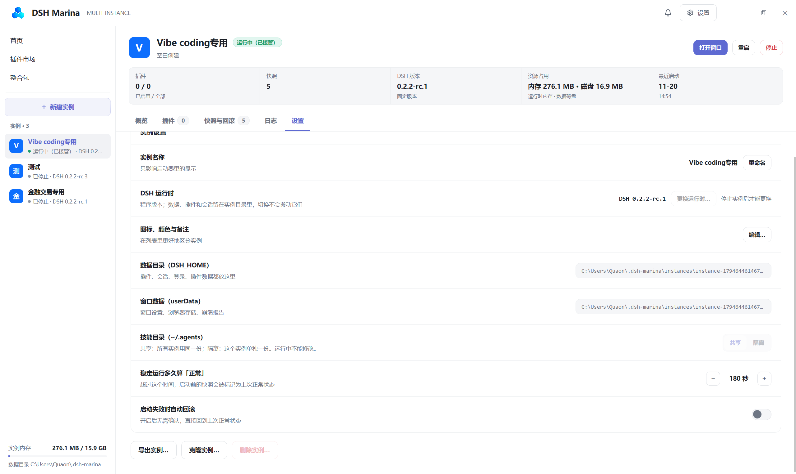
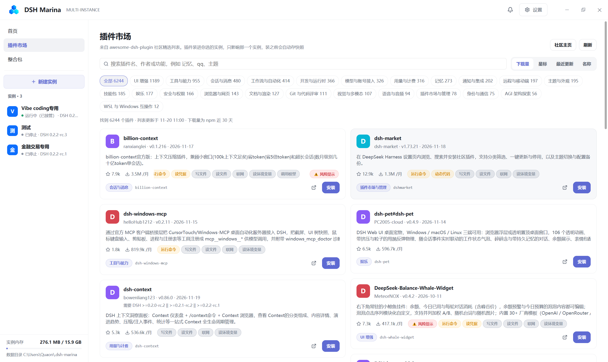
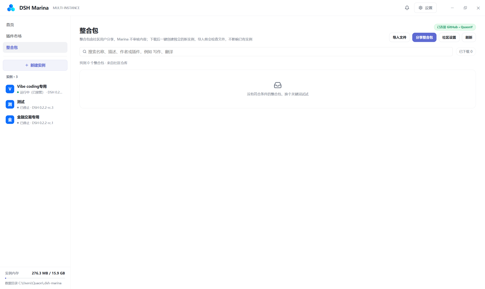
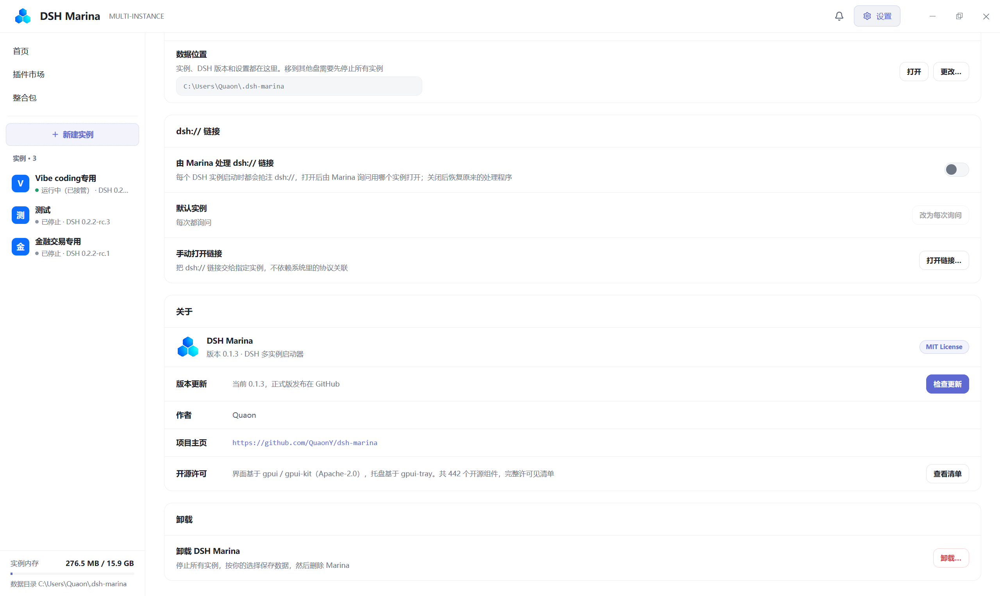

<p align="center">
  
</p>

<h1 align="center">DSH Marina</h1>

<p align="center">
  一个用 Rust 开发的高性能桌面启动器，用于并排运行多个相互隔离的
  <a href="https://github.com/deepseek-ai/deepseek-harness">DeepSeek Harness（DSH）</a>
  工作区（Windows 与 macOS）。
</p>

<p align="center">
  
  
  
</p>

<p align="center">
  <a href="README.md">English</a> · <strong>简体中文</strong>
</p>

<p align="center">
  源码：<a href="https://github.com/QuaonY/dsh-marina">GitHub</a> ·
  <a href="https://cnb.cool/QuaonY/dsh-marina">CNB</a> ·
  <a href="https://github.com/QuaonY/dsh-marina-packs">社区整合包</a>
</p>

---

DSH 默认只读取一份用户配置。Marina 为每个工作区分配独立的 `DSH_HOME`、Electron 数据目录、插件集合和日志，因此多个 DSH 版本可以同时运行，互不干扰。它还负责这套环境周边的日常操作：启动与停止、安装运行时、创建快照、崩溃恢复，以及把配置好的环境分享给别人。

Marina 是独立的启动器，而不是 DSH 的分支：它使用隔离的路径启动官方 DSH 版本。

## 平台支持

| 平台 | 架构 | 最低版本 | 安装包 |
| --- | --- | --- | --- |
| Windows | x64 | Windows 10 21H2（DirectX 11） | NSIS 安装器 |
| macOS | Apple Silicon（arm64） | macOS 13 Ventura | `.dmg` |

<p align="center">
  
</p>

<p align="center"><sub>一个窗口管理所有实例、版本、插件和快照。</sub></p>

## 快速开始

### Windows

1. 下载安装包 `dsh-marina-setup-v<版本>-windows-x64.exe` 运行安装。
2. 新建实例，并选择 DSH 运行时版本，或让 Marina 自动下载。
3. 启动实例。插件、快照、整合包和托盘都在同一个窗口里管理。

安装器按当前用户安装（无需管理员权限），会创建桌面快捷方式、开始菜单项，并出现在「应用和功能」里。

### macOS

1. 下载 `dsh-marina-v<版本>-macos-aarch64.dmg`，打开后把 **DSH Marina** 拖进「应用程序」；或用 Homebrew：

   ```bash
   brew tap QuaonY/dsh-marina
   brew install --cask dsh-marina
   ```

2. **首次放行（重要）**：Marina 采用免费的 ad-hoc 签名（没有 Apple Developer 账号），macOS 会拦截未公证的应用。第一次打开时若提示「无法验证开发者」，前往 **系统设置 → 隐私与安全性**，在下方点 **「仍要打开」** 并输入密码即可。之后正常双击启动。
3. 新建实例并启动。

## 功能

### 实例管理

- 创建、重命名、克隆和删除工作区，每个实例可以设置独立的主题色。
- 克隆默认不包含会话、凭据、匿名身份和 Electron 登录状态。只有源实例处于停止状态时，才允许勾选「同时复制个人数据」。
- 删除提供三种安全方式：先导出再删除、在 `trash` 中保留 30 天，或移动到系统回收站（Windows 回收站 / macOS 废纸篓）。
- 首页集中展示所有实例、绑定的运行时以及当前运行状态。

<p align="center"></p>

<p align="center"></p>

### 进程生命周期

- Windows 上每个实例运行在独立的 Job Object 中；macOS 上以独立进程组管理。
- 停止时先发送温和的关闭信号（Windows `WM_CLOSE` / macOS 终止信号），等待 30 秒后再强制结束整个进程树。
- Marina 重启后，会接管仍在运行的实例。
- 从 `dsh web: http://127.0.0.1:<port>/` 这一行判断启动是否就绪，并探测端口进行确认。
- DSH 的标准输出和错误输出写入 `marina/stdout-*.log`，其中令牌会被脱敏，文件上限为 4 MB。

<p align="center"></p>

### 插件

- 列出第三方插件，并通过 `cordis.patch.yml` 启用或禁用；每次修改前自动备份。
- 工作区无法启动时，可以一键进入安全模式。
- 通过运行时自带的 `dsh plugin --profile desktop` CLI 卸载插件、重装依赖。
- 实例运行期间拒绝任何插件写入，避免在 DSH 使用过程中改动配置。

### 插件市场

- 浏览远程索引，可按名称、标题、作者、描述、分类和声明的能力搜索；查询中的每个词都必须匹配。
- 将插件安装到指定实例，并查看下载量和星标数。
- 会遵循实例的运行状态：目标实例正在运行时，安装和修改插件都会被禁用。

<p align="center"></p>

### 快照与救援

- 支持手动快照，并在每次启动前自动创建快照。
- 将稳定运行过的状态标记为「上次正常」。
- 崩溃后可以定位可疑插件、禁用它们，或回滚到「上次正常」：恢复快照、重装插件依赖，然后可选地重新启动。
- 可选的自动回滚，默认关闭。

<p align="center"></p>

### 运行时

- 同时保留多个 DSH 版本，实例可以绑定指定版本或「最新稳定版」。
- 下载源支持官方源（nightly 或 stable）、GitHub Releases、GitHub 镜像前缀或自定义源，并自动回退。
- 支持断点续传与 SHA-512 校验；Windows 走 NSIS 静默安装，macOS 用 `ditto` 解开官方 `.zip`（保留 `.app` 内的符号链接）。
- 放入 `runtimes/` 的安装包可以离线安装。
- 每天检查一次新版本；安装数量超过 `max_runtimes` 时会提示清理。
- 官方发布新版本后，可以直接把已有实例升级到新运行时：在实例「设置」里点「更换运行时…」，原地切换 DSH 版本，数据、插件、会话和登录状态都不动。切换前会自动存快照，出问题可以「换回上一个运行时」；也可以在这里改回跟随「最新稳定版」。

<p align="center"></p>

### Marina 整合包

- 将实例导出为 `.marina-pack.zip`，也可以再次导入。
- 通过 GitHub Device Flow 和 `public_repo` 权限分享到社区：Marina 先把压缩包发布到用户的 `dsh-marina-shared-packs` 仓库 Release，再向
  [QuaonY/dsh-marina-packs](https://github.com/QuaonY/dsh-marina-packs) 提交包含元数据的 Pull Request。校验会自动运行，最终由维护者合并。
- 分享流程会扫描导出的文件，并对凭据和本地绝对路径做脱敏。

<p align="center"></p>

### 托盘与桌面集成

- 关闭窗口时隐藏到系统托盘；左键单击/双击托盘图标即可唤回主窗口，右键打开托盘菜单，退出从菜单执行。
- 每个实例都有独立的托盘菜单；托盘提示显示运行数量和总内存。
- 支持开机自启、单实例运行，以及可选的退出确认（会列出正在运行的实例）。
- 卸载时可以分别选择是否保留用户数据。

<p align="center"></p>

### 关于

- 显示版本、MIT 许可证、仓库地址和完整的第三方许可清单。

<p align="center"></p>

### 版本更新

- 每次启动 Marina 时检查一次更新清单（GitHub 原始文件优先，连不上时改查 CNB 镜像）。发现新版本会在消息铃铛上亮红点。
- 更新弹窗显示当前版本和新版本、这一版的更新说明，以及跳转到 GitHub 的链接。
- 「下载并更新」会显示进度，下载完成后按清单校验更新包的 **SHA-256**，再提供「重启并更新」和「稍后更新」。Windows 下载 NSIS 安装器，macOS 下载 `.app.tar.gz`。
- 有实例在运行时点重启会先提示；选「退出时再更新」会在下次退出 Marina 时安装。Windows 安装器以被动模式运行并自动重启，macOS 替换 `.app` 后重启。
- 可以在「设置 > 通用」里关掉自动检查。

## 数据与隐私

所有内容默认位于用户主目录下的 `.dsh-marina`（Windows `%USERPROFILE%\.dsh-marina\`，macOS `~/.dsh-marina/`）：

```text
.dsh-marina/
├─ marina.toml
├─ instances/
│  └─ <id>/
│     ├─ home/          DSH_HOME
│     ├─ electron/      Electron --user-data-dir
│     ├─ marina/        Marina 的实例状态和标准输出日志
│     └─ snapshots/
├─ runtimes/<version>/
├─ download/
├─ updates/             自更新下载与待安装包
├─ trash/
├─ github_token.json    加密存储的 GitHub 令牌
└─ marina.log
```

- 数据目录可以在设置中修改。Marina 会先移动文件、校验副本，确认无误后才删除旧目录。
- 不会在程序旁边写入任何内容，因此程序可以随意移动或替换。
- GitHub 令牌在 Windows 上用 DPAPI 加密、在 macOS 上存入系统钥匙串（Keychain），只有当前用户能够解密。日志和导出的整合包会脱敏令牌、凭据和本地绝对路径。
- Marina 不包含统计或遥测。联网只发生在功能需要时：检查更新、下载运行时、插件市场和社区分享。

## 从源码构建

### 环境要求

- Rust 1.88 及以上（edition 2024）
- Windows：Windows 10 21H2+、DirectX 11 驱动、Visual Studio Build Tools 与 Windows SDK（提供 `rc.exe` 生成窗口图标）
- macOS：macOS 13+、Xcode Command Line Tools（提供 Metal 着色器编译与 `ditto`）

### 构建

```bash
cargo build --release
```

Windows 产物位于 `target\release\dsh-marina.exe`，macOS 位于 `target/release/dsh-marina`，发布构建不带控制台窗口。

Windows 可执行文件完全自包含：资源全部编译进 exe，`.cargo/config.toml` 将 MSVC C 运行库静态链接，因此不需要 `VCRUNTIME140.dll`，也不需要安装 Visual C++ 运行库。图标会在构建时由 `assets/logo.png` 生成（Windows 生成 `.ico`，macOS 生成 `.icns`）。

### 打包发布（全 Rust，`cargo xtask`）

发布编排全部由 Rust 写的 `xtask` 完成，不再依赖 PowerShell / NSIS 手写脚本：

```bash
# 在当前平台构建 + 打包，产物 + SHA-256 + 平台片段写入 dist/
cargo xtask package

# 合并各平台片段 + CHANGELOG 中对应版本章节，组装 update.json
cargo xtask manifest --tag v<版本> --notes CHANGELOG.md
```

- Windows 产出 NSIS 安装器（更新包）+ 其 `.sha256`；macOS 产出 `.app.tar.gz`（更新包）+ `.dmg`（全新安装）。
- `update.json` 兼容旧版清单：保留 `tag_name/html_url/body/assets` 供 v0.1.2 旧客户端读取，同时带上 `version/notes/pub_date/platforms` 供新版自更新使用。
- 推送即全自动发布：`.github/workflows/release.yml` 双端打包、发 GitHub Release、把 `update.json` 提交回 main，并在配置 `CNB_GIT_TOKEN` 时同步 CNB 代码、配置 `CNB_TOKEN` 时在 CNB 创建 Release 并上传全部附件。发版只需 bump `Cargo.toml` 版本 + 在 `CHANGELOG.md` 追加 `## <版本>` 章节（中英双语、最新在前）后推送，无其它手动步骤；流水线自动抽取该章节作为 Release 说明。
- `.github/workflows/ci.yml` 在 PR 上做双端 fmt / clippy / test 门禁。两个工作流都不需要签名密钥；`CNB_GIT_TOKEN` / `CNB_TOKEN` 可选、仅用于 CNB 镜像与 CNB Release。

## 开发

```bash
cargo fmt --check
cargo clippy --all-targets -- -D warnings
cargo test
cargo run
```

`cargo build` 会保留控制台窗口以便查看日志；`cargo build --release` 则会隐藏控制台。CI 在 Windows 与 macOS（arm64）两个 runner 上分别跑格式化、clippy 和测试。

### 手动测试

自动化测试覆盖核心逻辑。以下项目仍需要在真实桌面上验证：

- 从不同运行时源下载（Windows NSIS 静默安装 / macOS `ditto` 解包）
- `dsh plugin` CLI 集成
- 托盘行为和界面交互（含左键唤回主窗口）
- 进程生命周期细节（Windows Job Object / macOS 进程组）
- 自更新：Windows NSIS 被动安装 + 自动重启、macOS 替换 `.app` + 重启，以及「退出时再更新」
- macOS Gatekeeper 首次放行与更新后再次放行
- GitHub 分享流程（Device Flow、Release 上传、Pull Request）

## 技术栈

| 方面 | 使用 |
| --- | --- |
| 界面 | [gpui-kit](https://github.com/longbridge/gpui-kit) |
| 系统托盘 | [gpui-tray](https://github.com/domenkozar/gpui-tray) |
| 系统集成 | Windows `windows` crate（Job Object、注册表、Shell）；macOS `objc2` / `libc` / `security-framework` |
| 网络 | `reqwest`，使用原生 TLS 和系统代理 |
| 数据格式 | serde、TOML、YAML、JSON 和 ZIP |
| 打包 | [cargo-packager](https://github.com/crabnebula-dev/cargo-packager)（NSIS / `.app` / `.dmg`） |
| 自更新 | [cargo-packager-updater](https://github.com/crabnebula-dev/cargo-packager)（SHA-256 校验） |
| 发布编排 | `xtask`（全 Rust） |

## 项目结构

```text
src/            应用模块（实例、进程、插件、整合包、平台抽象等）
src/platform/   Windows / macOS 平台抽象（窗口、单实例、磁盘空间）
src/process/    进程后端（Job Object / 进程组）
src/ui/         GPUI 视图、对话框和标签页
src/bin/        集成测试使用的 fake-desktop 测试替身
tests/          进程生命周期集成测试
xtask/          全 Rust 发布编排（打包、SHA-256、清单组装）
packaging/      Homebrew Cask 模板等分发物料
assets/         图标、Logo、截图和第三方许可清单
CHANGELOG.md    累计式双语更新日志（每版本一节）
```

## 参与贡献

欢迎提交 Issue 和 Pull Request。

## 许可证

MIT，详见 [LICENSE](LICENSE)。

## 致谢

- 作者与维护者：Quaon
- DeepSeek Harness 由 DeepSeek 开发：[deepseek-ai/deepseek-harness](https://github.com/deepseek-ai/deepseek-harness)
- 基于 GPUI 构建
- 使用 gpui-kit 组件库
- 第三方许可：[assets/THIRD-PARTY-LICENSES.txt](assets/THIRD-PARTY-LICENSES.txt)